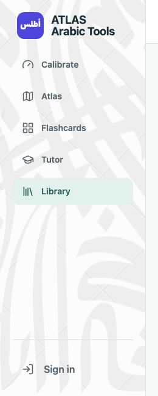
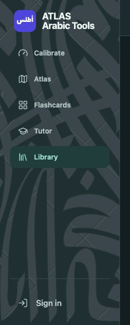
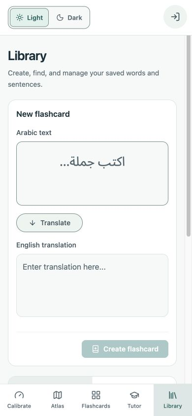
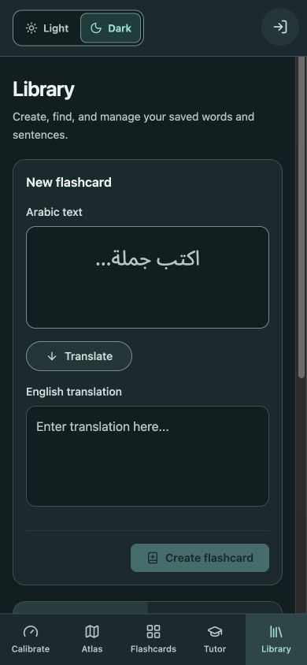

# ATLAS redesign review

This branch contains the complete approved redesign: the shared visual refresh, mint/teal light and dark themes, appearance control, calibration-first navigation and entry, page purpose sentences, learning-state legends, responsive layouts, and the final Arabic calligraphy sidebar. The standalone geometric motif has been removed. ATLAS branding and Noto Sans Arabic are retained.

## Approved screenshots

Existing captures of the final design, using disposable local data. The sidebar images are crops from a 1366 × 650 viewport; phone captures are 390 × 844. Open an image for its original size.

| Light sidebar | Dark sidebar |
| --- | --- |
|  |  |

| Light phone layout | Dark phone layout |
| --- | --- |
|  |  |

## Changes to review

- Consistent headings, labels, controls, panels, dialogs, tables and keyboard focus across Atlas, Flashcards, Tutor, Library, Calibrate and account interfaces. Arabic reading regions retain RTL layout and room for diacritics; English remains LTR.
- Exact purpose sentences and concise legends explain existing known, unknown, target, missed and unsaved states where relevant. Existing learning meanings are preserved.
- The supplied calligraphy is a bundled local asset on a separate, non-interactive sidebar layer. One proportional crop spans its height. Only that layer receives the dark-theme treatment; menus and focus rings are not clipped. Phone navigation remains the existing five-item bar.
- **Approved appearance behavior:** Light is the default. Light/Dark uses only `atlas.ui.theme`, handles unavailable storage and initializes before paint. Switching themes does not reload or replace stateful screens; Tutor stays mounted after its first visit. Atlas repaints its colors without changing map geometry.
- **Approved calibration behavior:** Calibrate appears first. Automatic initial entry requires successfully retrieved unfinished calibration, no saved steps and zero known words. `mode === "done"` remains complete even with zero known words; saved steps produce a Continue calibration cue; imported knowledge retains normal entry. Explicit Atlas links and navigation take precedence over late responses. Only actual server completion shows the completion panel. Initial completion continues to Atlas; manual entry returns to the previous view.

Learning algorithms, API contracts, authentication implementation, data files, dependencies, deployment configuration, grading/scheduling, editor behavior and flashcard flip/swipe CSS are preserved. The two interface behavior changes above are intentional; the remaining changes are presentation.

## Run locally

Use a fresh checkout for disposable review data. Prerequisites: Git, Node/npm and Python 3 with venv support. Keep production database URLs and service credentials out of the review environment; the default backend uses the bundled SQLite seed data.

```sh
git clone --branch ui/atlas-redesign-review https://github.com/j-alsereidi/learn-arabic.git
cd learn-arabic
python3 -m venv .venv
source .venv/bin/activate
python -m pip install -r requirements.txt
INSTANCE_PATH="$PWD/instance/review" python run.py
```

In another terminal, from the same checkout:

```sh
cd frontend
npm ci --no-audit --no-fund
npm start
```

Open <http://localhost:3000>. The existing development proxy forwards API requests to `127.0.0.1:5001`; close the sign-in dialog to use guest access. Review databases stay under the ignored `instance/review` directory. Successful Tutor generation and translation may require the existing service configuration; account authentication requires suitable test credentials. No new environment settings or services are introduced by this branch.

## Verification and limitations

The final approved application source was preserved during publication preparation. Checks on 20 November 2026:

```sh
cd frontend
CI=true npm test -- --watchAll=false --runInBand
npm run build
```

- Frontend build: passed. Existing Browserslist stale-data and Node `fs.F_OK` deprecation warnings remain.
- Existing focused tests: 28 passed in 3 suites. They cover theme initialization/storage, calibration entry classifications, late/failing status, manual return, and Tutor component lifetime. App tests mock child screens; these are not comprehensive end-to-end regression tests.
- Local browser checks covered both themes at 390px, 768px and 1440px widths; sidebar crops at 650px and 1000px heights; navigation, focus, guest dialog access, calibration cues, theme persistence and preservation of Tutor drafts, Library edits and calibration selections. No unintended page-level horizontal overflow was observed. Real disposable sessions exercised fresh, partial, imported and completed-zero calibration, Atlas deep links, Library editing and flashcard free practice.
- Focused source comparisons preserved 288 protected bindings, the existing flashcard behavior CSS, authentication initialization and Tutor's kept-mounted structure. No data-changing tests used the live team deployment.
- **Not verified:** successful Tutor replies and their notification/export/save workflows, successful external translation/ambiguity resolution, and completed authentication/account-setting flows because services or credentials were unavailable. Actual browser zoom, physical-device keyboard/touch behavior, a complete screen-reader audit and exhaustive learning-state/scheduling combinations remain gaps. The local missing `OPENAI_API_KEY` and translation-service failures were not fixed as part of this redesign.

## Publication and automation scope

This is a review branch targeting `supabase`; it is not a deployment. Before publication, the current base had no tracked GitHub Actions workflows or hosting/deployment manifests. GitHub reported zero Actions workflows/runs and no deployment records. The Pages endpoint returned 404. Repository webhooks, installed hosting integrations and the external configuration serving `sdp.jasem.dev` were not accessible for verification; no settings were changed. No known production deployment trigger was found in the available configuration.
